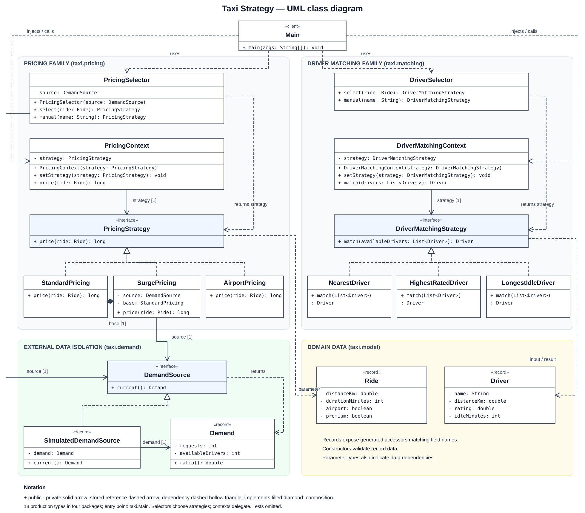

# Assignment 5 Taxi Strategy

Variant 3, Ride-Hailing. This Java console program calculates a fare and selects a driver using two independent families of interchangeable algorithms. Each family has three strategies, its own context, a separate automatic selector, manual selection, runtime switching, and JUnit 5 tests.

## UML class diagram



[Open full-size SVG](docs/class-diagram.svg) · [Download PNG](docs/class-diagram.png) · [Editable PlantUML source](docs/class-diagram.puml)

All 18 production types are shown. Solid arrows indicate stored references; dashed arrows indicate dependencies; dashed lines with hollow triangles indicate interface implementation. The filled diamond shows that SurgePricing creates and owns its StandardPricing helper. Constructor injection is an association, since the injected strategy or demand source can be shared. Selectors return concrete strategy implementations; contexts call the interfaces. Record accessors, implicit constructors, and test classes are omitted for readability.

## Build and run

Requires **JDK 17 or newer** and **Maven 3.9 or newer**. No application libraries or real API keys are required. JUnit 5 is the only dependency and is used only for tests. The first Maven run needs internet access to download build tools and JUnit.

```powershell
mvn clean verify
java -jar target/taxi-strategy-1.0.0.jar
```

On Windows, `./run.cmd` builds and starts the Russian interactive menu in one command. With no arguments, the JAR also opens this menu. To run the fixed demonstration without prompts:

```powershell
.\run.cmd --demo
# Or, after building:
java -jar target/taxi-strategy-1.0.0.jar --demo
```

Additional arguments still run a custom demonstration without prompts:

```powershell
.\run.cmd 25 40 true true 100 10
```

The six optional arguments are `distanceKm durationMinutes airport premium requests availableDrivers`. Supply all six to bypass the menu. Booleans accept `true` and `false`. Invalid CLI arguments print an error and exit with status 1. Distances are kilometres, time is minutes, prices are whole **KZT**, rounded to the nearest tenge with `Math.round`. All figures are fictional coursework tariffs.

The demo prints the same ride through all three pricing algorithms, then the automatic selection. It also prints the same available-driver list through all three matching algorithms, then the automatic selection. Each loop reuses one context and calls `setStrategy()` during execution.

## Interactive menu

1. Choose **New trip** (`1`), then **City** (`1`) or **Airport** (`2`).
2. Enter distance and duration; choose ordinary or premium customer. Decimal distances accept a dot or comma.
3. Choose the simulated external demand scenario: ordinary (10 requests / 10 drivers) or high (20 / 10). This configures the simulated source; it does not select the fare directly.
4. For the current trip, choose **Automatic** (`1`), **Manual** (`2`), or **Compare all** (`3`).
5. Manual mode asks you to choose the pricing strategy and the driver strategy independently. Automatic mode delegates both decisions to the selectors.
6. Change the mode repeatedly for the same ride. Its PricingContext and DriverMatchingContext are reused with `setStrategy()`. Compare all prints the full same-input demonstration, including runtime switching in its comparison contexts.
7. Choose **Back** (`0`) to enter another trip, then **Exit** (`0`) to close the program. End-of-input also exits cleanly.

Invalid menu values are re-requested at the current prompt. Choosing city or airport supplies the trip category; the simulation calculates from entered distance and time. The three available drivers are displayed with their selection data.

Example defense sequence: airport, 25 km, 40 min, premium customer, high demand. In manual mode choose standard fare and longest-idle driver: **4300 KZT, Miras**. Without re-entering the trip, choose automatic mode: **5500 KZT, Dias**, since airport pricing and premium matching take precedence. Compare all then shows every algorithm on these same inputs. This menu fulfills the assignment's console-demo requirement.

## Algorithms and selection rules

| Family | Strategy | Algorithm |
|---|---|---|
| Pricing | StandardPricing | 500 KZT pickup + 120 per km + 20 per minute |
| Pricing | SurgePricing | Standard fare multiplied by current requests / available drivers, clamped to 1..3 |
| Pricing | AirportPricing | Fixed 4500 KZT including 20 km, plus 200 per excess km; duration does not affect the fare |
| Matching | NearestDriver | Minimum pickup distance |
| Matching | HighestRatedDriver | Maximum customer rating |
| Matching | LongestIdleDriver | Maximum time waiting for a job |

The pricing algorithms use distance/time accumulation, an external demand calculation, and a fixed package with an excess-distance charge. They are not copies with different discount percentages. Matching changes the optimization criterion. Matching ties use alphabetical driver name, so equal scores produce a deterministic result. The input list contains drivers already available for this ride; the algorithms never modify it. An empty pool raises an explicit error.

Only selectors make decisions about **which strategy** to choose. Input validation and each algorithm's own calculations remain in their appropriate classes.

| Selector | Priority | Situation | Choice |
|---|---|---|---|
| PricingSelector | 1 | Airport trip | AirportPricing |
| PricingSelector | 2 | Non-airport trip, demand ratio >= 1.5 | SurgePricing |
| PricingSelector | 3 | Remaining trips | StandardPricing |
| DriverSelector | 1 | Premium customer | HighestRatedDriver |
| DriverSelector | 2 | Non-premium airport trip | LongestIdleDriver |
| DriverSelector | 3 | Remaining trips | NearestDriver |

The airport matching policy gives longer-waiting drivers priority for these trips; it is a business rule of this simulation. Premium takes precedence when both flags are true. `manual(name)` maps a user's explicit choice to a strategy inside the selector. Neither context contains strategy-type conditionals.

## Live demonstration

The `--demo` input is 10 km, 15 minutes, ordinary trip, ordinary customer, 20 requests, 10 available drivers.

```text
standard -> 2000 KZT
surge -> 4000 KZT
airport -> 4500 KZT
Automatic: SurgePricing -> 4000 KZT

nearest -> Aruzhan
rated -> Dias
idle -> Miras
Automatic: NearestDriver -> Aruzhan
```

The pool is Aruzhan (1 km, rating 4.6, idle 5 min), Dias (3 km, rating 4.9, idle 12 min), Miras (2 km, rating 4.7, idle 40 min).

After building, use these commands to demonstrate every automatic rule and both precedence cases:

```powershell
# Low demand: standard fare, nearest driver
java -jar target/taxi-strategy-1.0.0.jar 10 15 false false 10 10
# Demand threshold: surge fare
java -jar target/taxi-strategy-1.0.0.jar 10 15 false false 15 10
# Premium customer: highest-rated driver
java -jar target/taxi-strategy-1.0.0.jar 10 15 false true 20 10
# Airport trip: airport fare, longest-idle driver
java -jar target/taxi-strategy-1.0.0.jar 25 40 true false 100 10
# Airport beats surge; premium beats airport matching
java -jar target/taxi-strategy-1.0.0.jar 25 40 true true 100 10
```

## Isolation from external change

`SurgePricing` depends on our `DemandSource` interface. It reads `current()` on each price request. `SimulatedDemandSource` provides validated counts from the selected menu scenario or demo arguments; no real API is needed. Replacing the source requires constructing a different `DemandSource` implementation and injecting it into `PricingSelector` or `SurgePricing`.

Tests inject a fake such as `() -> new Demand(20, 10)`. A separate test changes fake demand between calls to the same strategy to prove that the source is read again. Another test proves an external failure propagates instead of silently inventing a fare. Demand requires 0..1000000 requests and 1..1000000 available drivers, preventing division by zero. The demand denominator represents the simulated city-wide fleet; the three demo drivers are a separate eligible candidate pool.

## Class responsibilities

Each responsibility below is one sentence of at most 25 words without the words prohibited by the assignment.

| Class or interface | Responsibility |
|---|---|
| Ride | Holds validated trip details. |
| Demand | Holds validated city demand counts. |
| DemandSource | Defines access to current demand. |
| SimulatedDemandSource | Supplies configured demand values. |
| PricingStrategy | Defines the fare calculation contract. |
| StandardPricing | Calculates a metered fare from distance plus duration. |
| SurgePricing | Calculates a demand-adjusted metered fare. |
| AirportPricing | Calculates an airport package fare with excess-distance charges. |
| PricingContext | Delegates fare calculation to its replaceable strategy. |
| PricingSelector | Chooses a pricing strategy from trip conditions. |
| Driver | Holds validated driver selection data. |
| DriverMatchingStrategy | Defines the driver selection contract. |
| NearestDriver | Selects the closest available driver. |
| HighestRatedDriver | Selects the highest-rated available driver. |
| LongestIdleDriver | Selects the longest-waiting available driver. |
| DriverMatchingContext | Delegates driver matching to its replaceable strategy. |
| DriverSelector | Chooses a matching strategy from customer conditions. |
| Main | Runs the taxi console interface. |
| PricingContractTest | Verifies stable pricing behavior across refactoring. |
| DriverMatchingTest | Verifies matching algorithms against deterministic examples. |
| StrategyExtensionTest | Verifies strategy extension through injected dependencies. |
| MainTest | Verifies observable console demonstration behavior. |

## Why Strategy rather than State or Template Method

This program uses Strategy because a client can solve the same task through several interchangeable algorithms. Every pricing strategy accepts a Ride and returns a fare. Every matching strategy accepts an available-driver pool and returns one Driver. The context stores an interface reference, delegates the operation, and allows the client to replace that reference through setStrategy(). The selectors decide which policy fits the current trip. Those decisions are separate from executing the selected algorithm. The demo deliberately changes algorithms while keeping the inputs and context instance unchanged.

State primarily represents an object's lifecycle and the behavior associated with its current state. A trip might progress through REQUESTED, ACCEPTED, and COMPLETED in a State design. Standard, surge, and airport pricing are alternative calculation policies, not stages that a trip must pass through. Our strategies neither advance a lifecycle nor replace themselves after an operation. Selection belongs to the client or selector, so airport and premium flags are selection inputs rather than lifecycle transitions.

Template Method defines a fixed algorithm skeleton in a superclass and lets subclasses override selected steps. Here there is no inherited skeleton shared by contexts and algorithms. Composition connects a context to an independent strategy object. A new strategy implementation can be supplied through the existing constructor or setter without editing the context or existing algorithms. StrategyExtensionTest demonstrates that extension with new interface implementations. Exposing an additional named CLI option or adding an automatic selection rule can require changing a selector; the delegated operation and existing strategies remain unchanged.

## Refactoring history

1. [Before: switch-based pricing with contract tests](https://github.com/Anuarrich0/Strategy_pattern/commit/c7553a479d7b361f857ea5da1103051849216f01). PricingContext owns all three algorithms and branches on the selected pricing name.
2. [After: Strategy refactoring with driver matching and console demo](https://github.com/Anuarrich0/Strategy_pattern/commit/43a1e4fb2326739967067846def673fc2e562577). Algorithms move to StandardPricing, SurgePricing, and AirportPricing. PricingContext becomes a simple delegate accepting PricingStrategy. The driver family and full demo are added.

`PricingContractTest.java` is unchanged between these commits. Its 19 invocations check exact prices, airport excess-distance boundaries, surge floor/cap, all pricing selector branches, runtime switching, invalid inputs, and a nonnegative-fare property across all three strategies. The baseline passed all 19 before the refactor.

The tests call `new PricingContext(selector.manual(name))` on both commits. The selector returns a legacy Choice in the baseline and a PricingStrategy after extraction; tests do not depend on that internal representation. Both commits compile independently.

To inspect or reproduce the baseline without disturbing your current working files:

```powershell
git show c7553a4:src/main/java/taxi/PricingContext.java
git worktree add --detach ../taxi-before c7553a4
mvn -f ../taxi-before/pom.xml test
```

## Tests and requirement checklist

Run `mvn clean verify`. JUnit XML/text reports appear in `target/surefire-reports/`; the runnable JAR appears in `target/`. No live services, current time, random values, or shared mutable fixtures are used.

Verified on JDK 21 with Maven 3.9.12: **51 test invocations, 0 failures, 0 errors, 0 skipped**. The baseline passed its 19 pricing checks; the final version passes the same 19 plus 32 matching, extension, and console checks. Console tests cover manual-to-automatic switching, overriding automatic policy, all-strategy comparison, decimal commas, multiple trips, retrying invalid input, explicit exit, and closed input. The actual `run.cmd` was exercised in a terminal with an airport/premium trip, manual selection, automatic selection, comparison, and clean exit. Russian menu text displayed correctly. The non-interactive demo and invalid-argument exit status are also verified.

| Requirement | Implementation or evidence |
|---|---|
| Two families with three distinct algorithms each | PricingStrategy, DriverMatchingStrategy, six concrete classes |
| One interface with 1-2 methods per family | One operation on each interface |
| Constructor injection plus runtime replacement | Both contexts expose constructors plus setStrategy() |
| No strategy-type branching inside contexts | Both contexts delegate through their interface fields |
| Separate automatic selectors | PricingSelector, DriverSelector |
| Before/after commits with the same passing tests | Refactoring history, unchanged PricingContractTest |
| External source isolated behind an interface | DemandSource injected into SurgePricing |
| Fake source in tests | Fixed-value lambdas in PricingContractTest and StrategyExtensionTest |
| Test for every concrete strategy | Exact expected-result tests in both families |
| Every selector rule | Boundary, fallback, premium, airport, precedence tests |
| Parameterized family-wide property | everyFareIsNonNegative; everyStrategyReturnsAnAvailableDriverWithoutChangingInput |
| Manual, automatic, runtime demonstration | Main, run.cmd, documented CLI examples |
| Class responsibility table | All named production types plus test classes listed above |
| Strategy versus related patterns | Reflection above |

During defense, add a new PricingStrategy or DriverMatchingStrategy implementation and pass it into the existing context. To change automatic policy, edit only the corresponding selector rule and its test. To swap the external source, inject a different DemandSource. The program is an educational taxi simulation, with fictional tariffs and drivers.
